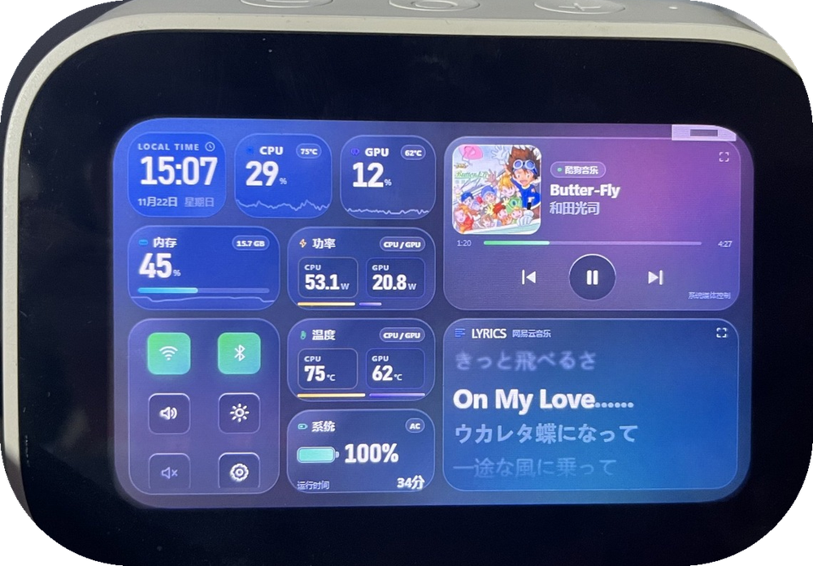

# PaperDeck

Windows 小副屏扩展。主屏放设置，副屏显示小组件，系统数据本地读取，歌词按需联网。

[](https://github.com/Paperpiece-Cloud/PaperDeck/releases)
[](#系统要求)
[](https://www.electronjs.org/)
[](LICENSE)


## 实机

运行在小爱同学 LX04 上（798×480 横屏）：



## 特性

- 798×480 横向副屏，自动适配 720P / 1080P / 4K，主屏设置窗口，副屏不占任务栏
- CPU、GPU、内存、功率、温度、网络、存储、时钟、系统、蓝牙电量小组件
- 12×8 网格布局，拖动移动，八条边框缩放
- 系统 SMTC 媒体信息、封面、播放控制、进度
- 歌词优先本地 LRC，找不到再走 LRCLIB、网易云、QQ、酷狗
- 网易云 YRC / Enhanced LRC 逐字歌词，翻译合并
- 全屏歌词，左侧封面和媒体按钮，右侧滚动歌词
- 控制中心：Wi-Fi、蓝牙、静音点击切换，状态同步系统
- 音量/亮度居中弹窗，长按或右键打开系统设置
- 主题、纯色/渐变/纯黑背景、玻璃、安全区、字体、触控按钮缩放
- 托盘、自启、截图、亮度、防休眠、配置持久化

## 系统要求

- Windows 10 / 11 x64
- Node.js 22+（源码运行）
- 一块 798×480 或类似的副屏；没有副屏时主屏显示 798×480 预览窗口
- 支持 720P / 1080P / 4K；以 798×480 为基准自动等比缩放，也可关闭自动缩放手动调字体
- 读取 NVIDIA GPU 数据需要安装显卡驱动并可用 `nvidia-smi`

## 安装

从 [Releases](https://github.com/Paperpiece-Cloud/PaperDeck/releases) 下载 `PaperDeck-1.0.0-x64.exe`。

安装包未做代码签名，SmartScreen 提示“未知发布者”时选择“更多信息 → 仍要运行”。

已经安装旧版时直接覆盖安装，配置会保留。

## 源码运行

```bash
npm install
npm start
```

开发模式：

```bash
npm run dev
```

构建：

```bash
npm run pack:dir   # 未打包目录
npm run dist       # NSIS 安装包
```

## 使用

| 操作 | 说明 |
| --- | --- |
| 打开设置 | 副屏右上角齿轮，或托盘双击 |
| 编辑布局 | 副屏右上角布局按钮，拖动卡片、拖边框缩放 |
| 数据刷新 | 设置 → 显示与副屏 → 数据刷新间隔 |
| 媒体全屏 | 点击媒体封面或歌词展开按钮 |
| 控制中心 | 点击图标切换开关；长按/右键打开系统设置 |
| 音量/亮度 | 点击控制中心图标，屏幕中央弹窗调整 |
| 本地歌词 | 设置 → 媒体与歌词 → 选择 LRC 目录 |
| 托盘 | 显示/隐藏副屏、编辑布局、始终置顶、退出 |
| 配置目录 | 设置 → 系统 → 打开配置目录 |

配置文件：

```text
%APPDATA%\PaperDeck\config.json
```

## 技术实现

```text
SMTC / WinRT ──> media.js ──> preload ──> display.js
typeperf / nvidia-smi ──> metrics.js
本地 LRC + LRCLIB / 网易云 / QQ / 酷狗 ──> lyrics.js
Windows Radio / Core Audio / DDC-CI ──> actions.js
```

- Electron 主进程负责窗口、托盘、配置和系统数据
- 两个渲染器只通过 preload 暴露的 IPC 通信，开启 `contextIsolation`，关闭 `nodeIntegration`
- 使用 Windows SMTC 读取媒体元数据和缩略图
- typeperf 读取 CPU 功耗/热区，常驻 `nvidia-smi` 循环读取 NVIDIA GPU
- PowerShell 桥接 SMTC、音量、亮度、Wi-Fi/蓝牙开关和蓝牙设备
- 布局和设置保存在本地 JSON，不使用账号或云端

更详细的模块说明见 [docs/ARCHITECTURE.md](docs/ARCHITECTURE.md)。

## 常见问题

**副屏没有画面**

在“显示与副屏”里手动选择目标屏幕，确认分辨率和显示模式；没有副屏时程序会在主屏中央生成预览窗口。

**GPU 一直显示 `--`**

先确认 `nvidia-smi` 能运行，并更新显卡驱动。笔记本双显卡机器会优先选择 NVIDIA 独显；如果仍为空，检查设置里的数据刷新间隔和硬件加速开关。

**封面不显示**

部分播放器不向 Windows SMTC 提供缩略图。先切换歌曲或重启播放器；程序会在切歌后强制刷新封面，不使用旧封面缓存。

**歌词不显示或匹配错**

优先把同名 `.lrc` 放到本地歌词目录，或在设置里调整歌词源顺序。系统媒体会话本身不提供歌词。

**翻译没有**

只有歌词源提供翻译时才会显示。可以在“媒体与歌词”里切换源或开启翻译开关。

**未知发布者**

安装包没有代码签名证书。选择“更多信息 → 仍要运行”即可。

**蓝牙电量显示 `--`**

Windows 没有向 PnP 上报该设备的电量；连接数仍会显示。

**CPU 占用高**

把“数据刷新间隔”调到 2/3/5 秒，关闭动态光斑和过渡，确认设置里开启了 GPU 硬件加速。

## 免责声明

本项目用于个人学习和桌面美化，不提供任何担保。媒体、封面和歌词数据的版权归原播放器、平台和版权方所有，本项目不提供音乐下载或破解功能。请遵守相关平台的服务条款。

## 许可证

[GPL-3.0-only](LICENSE) © 2026 Paperpiece

## 贡献

见 [CONTRIBUTING.md](CONTRIBUTING.md)。发布流程见 [docs/RELEASING.md](docs/RELEASING.md)。

如果这个项目对你有帮助，点个 Star 就行。
