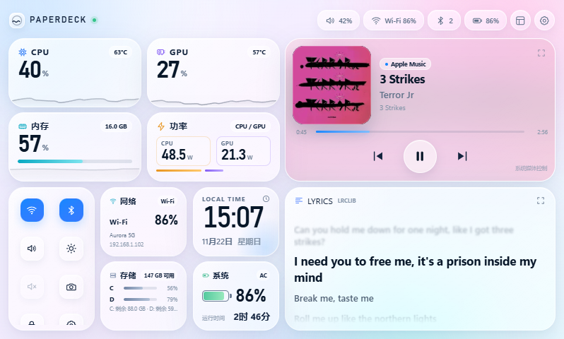

# PaperDeck

Windows 小副屏扩展
继SteamDeck后的现代UI副屏工具控件

## 实例

运行在小爱同学 LX04 上（798×480 横屏）：

## 特性

- 适配最高4K分辨率，同时兼容小屏幕，支持多点触控
- CPU、GPU、内存、功率、温度、网络、存储、时钟、系统、蓝牙电量小组件
- 网格布局，大小可改
- 媒体控件优先系统SMTP，下个版本可能会支持蓝牙音乐推送
- 歌词优先本地，获取不到认栽吧，变成在线获取
- 支持 YRC / Enhanced LRC 逐字歌词，好喜欢苹果音乐的html
- 全屏歌词也做了，点击专辑封面即可打开
- Wi-Fi、蓝牙等开关，状态和系统同步，长按操作和安卓苹果一样
- 纯色/渐变/纯黑背景、玻璃、安全区、字体、触控按钮缩放
- **副屏窗口不占用任务栏哦，因为我有强迫症哈哈哈哈哈哈哈哈**

## 系统要求

- 最低Windows 10，11最佳
- Node.js 22+编译
- 支持 480P/720P/1080P/4K
- 读取NVIDIA GPU数据需要安装显卡驱动并可用 `nvidia-smi`，顺序为NVIDIA->AMD->intel

## 安装

从 [Releases](https://github.com/Paperpiece-Cloud/PaperDeck/releases) 下载 `PaperDeck-1.0.0-x64.exe`。

**给爷记住一定要管理员身份**，建不起缓存打飞你  

## 使用

| 操作 | 说明 |
| --- | --- |
| 打开设置 | 副屏右上角齿轮，或系统托盘 |
| 编辑布局 | 副屏右上角布局按钮 |
| 数据刷新 | 设置 → 显示与副屏 → 数据刷新间隔 |
| 媒体全屏 | 点击媒体封面或歌词展开按钮 |
| 控制中心 | 点击图标切换开关，长按/右键打开系统设置里的对应设置 |
| 音量/亮度 | 点击控制中心图标，屏幕中间弹窗 |
| 本地歌词 | 设置 → 媒体与歌词 → 选择 LRC 目录 |
| 托盘 | 显示/隐藏副屏、编辑布局、始终置顶、退出 |
| 配置目录 | 设置 → 系统 → 打开配置目录 |

## 常见问题

**GPU 一直显示 `--`**

确认 `nvidia-smi` 运行，并更新显卡驱动。笔双显卡机器会优先选择 NVIDIA 独显  
如果仍为空，检查设置里的数据刷新间隔和硬件加速开关

**封面不显示**

部分播放器不向 Windows SMTC 提供缩略图，切换歌曲或更换播放器

**CPU 占用高**

把“数据刷新间隔”调到 2/3/5 秒，关闭动态光斑和过渡，开启 GPU 硬件加速

## 免责声明

本项目用于个人学习和桌面美化，不提供任何担保。  
媒体、封面和歌词数据的版权归原播放器、平台和版权方所有，本项目不提供音乐下载或破解功能。请遵守相关平台的服务条款。

## 许可证
本程序使用GPL-3.0许可，转载请保持开源  
[GPL-3.0-only](LICENSE)   
© 2026 Paperpiece
